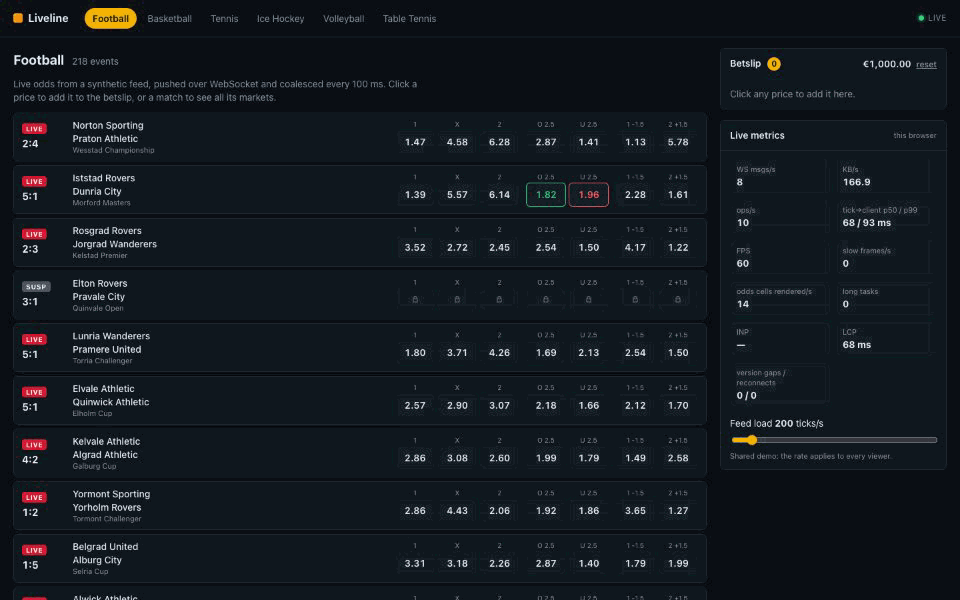
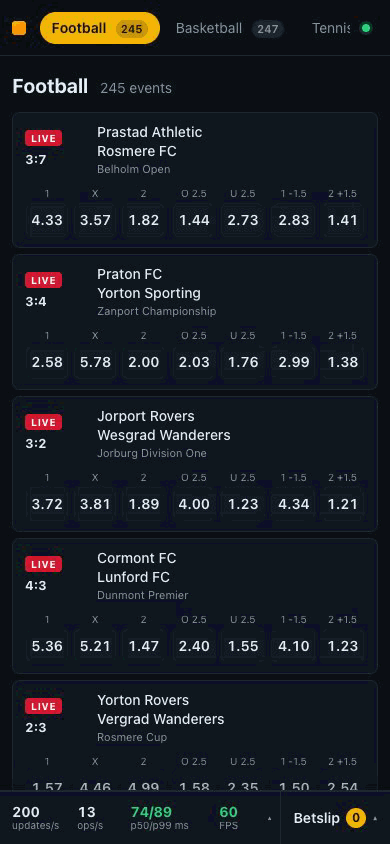
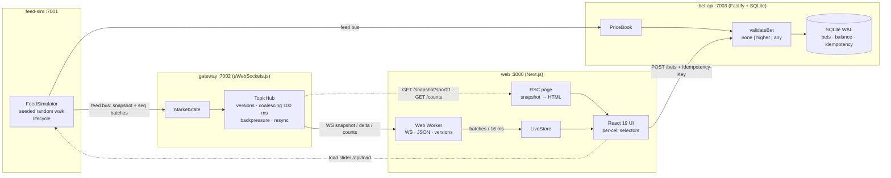

# Liveline

**▶ Live demo: [liveline-zeta.vercel.app](https://liveline-zeta.vercel.app/)**

A small but production-minded **live sportsbook**, end to end: synthetic odds feed → WebSocket
gateway → Next.js client → bet placement with odds validation. Every number below was measured;
the commands are in [METRICS.md](METRICS.md).

The live demo runs the web on Vercel and the gateway, bet API and feed on Fly.io; see
[deploy/](deploy/README.md). The load slider there is shared by every viewer.

[](https://liveline-zeta.vercel.app/)

<a href="https://liveline-zeta.vercel.app/"></a>

## What it shows

- **Feed** (`apps/feed-sim`): 1500 synthetic events, 18 533 markets, seeded random-walk odds,
  lifecycle prematch → live → suspended → settled, 50–2000 ticks/s (one tick = one market update;
  the UI calls it "market updates per second").
- **Gateway** (`apps/gateway`, uWebSockets.js): snapshot + delta per topic (`sport:{id}`,
  `event:{id}`), monotonic versions, coalescing every 100 ms, serialize once per topic,
  backpressure (skip deltas for slow sockets) and resync; event counts per sport pushed to every
  socket when they change.
- **Bet API** (`apps/bet-api`, Fastify + SQLite): validates odds against the current market,
  accept-change policy `none | higher | any`, `Idempotency-Key`, mock balance.
- **Client** (`apps/web`, Next.js App Router, React 19): server-rendered first rows, WebSocket +
  JSON parsing in a Web Worker, `useSyncExternalStore` selectors per odds cell, CSS-class odds
  flash, virtualized list, betslip (singles + multiples), live event count on each sport tab, live
  metrics panel with a load slider (green = good, red = bad, with a help text per metric). On
  phones: a bottom bar with a compact metrics strip that stays visible over the list, and separate
  sheets for the full metrics and the betslip.

## Architecture



### WebSocket protocol

```text
client → server  { t:"sub",   topics:["sport:1","event:42"] }
                 { t:"unsub", topics:[...] }
server → client  { t:"snapshot", topic, v, events:[...] }
                 { t:"delta", topic, from, v, ops:[...], ts }
                 { t:"counts", counts:{"1":248,"2":231,...} }   events per sport, on connect + on change
ops              { m, sel:{"1":2.15,"X":3.30} } | { m, st:"suspended" }      market
                 { e, est:"live", sc:[1,0] } | { add: event } | { rm: eventId } event
```

- Versions are per topic and monotonic. Ops carry **absolute** values, so a delta `from → v` can be
  applied to any client state in `[from, v)`. The client resyncs (re-subscribes → fresh snapshot)
  only when `from > its version` ([D10](DECISIONS.md)).
- `ts` is the feed time of the **oldest** change in the delta, so measured latency includes the
  coalescing wait ([D16](DECISIONS.md)).

### Key techniques

| where   | what                                                                                                                      | why                                                                                                     |
| ------- | ------------------------------------------------------------------------------------------------------------------------- | ------------------------------------------------------------------------------------------------------- |
| gateway | coalescing **per topic**: one pending map per topic, one delta per flush, serialized once, same bytes to every subscriber | per-client buffers would repeat the same merge and `JSON.stringify` N times ([D8](DECISIONS.md))        |
| gateway | backpressure: skip a socket above 512 KB buffered; it resyncs on the next gap; quiet topics get a catch-up snapshot       | a slow client never slows the others and never stays stale ([D12](DECISIONS.md))                        |
| gateway | snapshot cache per topic per flush window                                                                                 | reconnect storms serialize a 200 KB snapshot once per 100 ms, not once per client ([D11](DECISIONS.md)) |
| web     | WebSocket + `JSON.parse` + version checks in a **Web Worker**, posted in 16 ms batches                                    | the main thread only applies small batches                                                              |
| web     | `useSyncExternalStore` with per-market/per-selection keys, a stable "market shape" selector                               | a price tick re-renders exactly one odds button ([D18](DECISIONS.md))                                   |
| web     | odds flash = swapping two identical CSS animation classes on the DOM node                                                 | no React state, no forced reflow ([D19](DECISIONS.md))                                                  |
| web     | RSC renders the first 30 rows from a snapshot cached for 1 s; the WebSocket snapshot fills the rest                       | 35 → 16 KB HTML (gzip), 1 gateway request per sport per second ([D36](DECISIONS.md))                    |
| web     | own window virtualizer: row height per breakpoint in CSS, rows moved by `transform`                                       | 10 KB less JS than a library; server HTML laid out right on phones ([D37](DECISIONS.md))                |
| bet-api | lookup + validation + debit + insert + idempotency record in one synchronous SQLite transaction                           | 20 parallel requests with one key → exactly one bet ([D25](DECISIONS.md))                               |

## Measured numbers

Apple M5 Pro laptop; everything (services + load generator) on the same machine. Details, raw
files and commands: [METRICS.md](METRICS.md). The web rows (LCP, INP, FPS, JS) were measured again
on 2026-11-05, after the mobile bottom bar and the count badges (raw: `e2e/results/2026-11-05/`).

| target                           | result                                                                                                                                      | status                           |
| -------------------------------- | ------------------------------------------------------------------------------------------------------------------------------------------- | -------------------------------- |
| p99 tick→client < 150 ms         | **113 ms** at 2 000 clients, **134 ms** at 5 000 (k6); **149 ms** at 15 000 (Node load generator); includes the 100 ms coalescing window    | met                              |
| max clients per gateway instance | **15 000** verified within the p99 target (gateway at ~48% of one core). Higher not measurable on one macOS machine (ephemeral port limit). | lower bound                      |
| LCP < 1.5 s                      | **791 ms** mobile (simulated slow 4G, 4× CPU), **213 ms** desktop — Lighthouse 100/100/100                                                  | met                              |
| INP < 100 ms at 500 ticks/s      | **40 ms** (1× CPU), **32 ms** (4× CPU slowdown); 32 ms at 2 000 ticks/s with 4× CPU                                                         | met                              |
| ~60 FPS scrolling under load     | **59.9–60.2 FPS**, frame p95 16.7–16.8 ms, 0 long tasks (500 and 2 000 ticks/s, 1× and 4× CPU)                                              | met                              |
| initial JS < 120 KB gzip         | **146.8 KB** gzip (126.0 KB brotli). Next.js 16 + React 19 runtime alone is 128.8 KB.                                                       | **missed** ([D28](DECISIONS.md)) |
| bet placement                    | p99 **2.15 ms** at 200 bets/s, **7.32 ms** at 1 000 bets/s                                                                                  | —                                |
| backpressure                     | slow socket: 708 deltas skipped, 6 gaps → 6 resyncs, back in sync                                                                           | works                            |

## Run it locally

Node 22, pnpm 10.

```bash
pnpm install
pnpm build
pnpm start          # feed-sim :7001, gateway :7002, bet-api :7003, web :3000
```

Open <http://localhost:3000>. Dev mode with reload: `pnpm dev`.

| service  | env (defaults)                                                                                                                                                               |
| -------- | ---------------------------------------------------------------------------------------------------------------------------------------------------------------------------- |
| feed-sim | `FEED_PORT=7001 FEED_SEED=42 FEED_EVENTS=1500 FEED_RATE=200 FEED_LOG=summary\|ticks\|quiet`, optional `FEED_CONTROL_TOKEN`, `FEED_BUS_TOKEN`                                 |
| gateway  | `GW_PORT=7002 FEED_URL=ws://127.0.0.1:7001/feed GW_FLUSH_MS=100 GW_HIGH_WATER=524288 GW_MAX_TOPICS=50 GW_COMPRESSION=0`                                                      |
| bet-api  | `BET_PORT=7003 FEED_URL=... BET_DB=./data/bets.db WEB_ORIGIN=http://localhost:3000`                                                                                          |
| web      | `NEXT_PUBLIC_GATEWAY_WS=ws://localhost:7002/ws NEXT_PUBLIC_BET_API=http://localhost:7003 GATEWAY_HTTP=http://127.0.0.1:7002 FEED_HTTP=http://127.0.0.1:7001 LOAD_CONTROL=on` |

## Tests

```bash
pnpm test        # vitest: protocol, feed-sim, gateway (coalescing, backpressure, resync,
                 # randomized replica test), bet-api (validation, idempotency), web store
pnpm e2e         # Playwright with the installed Chrome (needs `pnpm build`)
cd e2e && E2E_BASE_URL=https://liveline-zeta.vercel.app pnpm exec playwright test   # against the live site
pnpm lint && pnpm typecheck && pnpm format:check
```

## Load tests

```bash
VUS=5000 RAMP=60s HOLD=60s sh load/step.sh                         # k6 in Docker
node load/swarm.mjs --clients 15000 --procs 8 --ramp 60 --hold 60   # Node generator
node load/slow-client.mjs --pause 90                                 # real backpressure
node e2e/measure-runtime.mjs --rate 2000 --cpu 4                     # FPS / INP in Chrome
node e2e/measure-paint.mjs --mobile --gap 1200                       # FCP / LCP / CLS, throttled phone
node load/page-load.mjs --rate 50 --duration 30                      # server render under load
node e2e/delay-proxy.mjs --delay 300                                 # slow gateway for the web server
```

## Repository

```text
packages/protocol   types + zod schemas (WS protocol, feed bus, bet API)
apps/feed-sim       synthetic feed + feed bus server + client (@liveline/feed-sim/client)
apps/gateway        uWebSockets.js gateway (MarketState, TopicHub)
apps/bet-api        Fastify + SQLite bet API
apps/web            Next.js client
load/               k6 scripts, Node load generator, slow client, results
e2e/                Playwright tests, Lighthouse CI, measurement scripts, results
deploy/             Fly.io configs + deploy guide (web on Vercel)
```

Design decisions with alternatives: [DECISIONS.md](DECISIONS.md). Known problems: [BLOCKERS.md](BLOCKERS.md).

## Not done yet

- Numbers in this README were measured on one laptop, not on the deployment. The deployed
  backend runs on 256 MB shared-CPU machines; it has not been load-tested.
- Phase 2: Redis pub/sub between feed-sim and 2+ gateway instances.
- All data is synthetic. No third-party or operator APIs are used.
